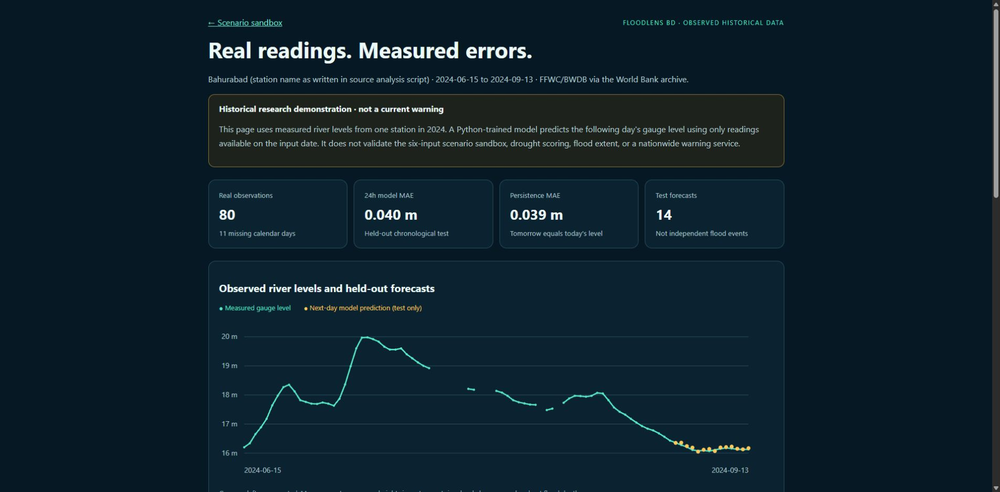
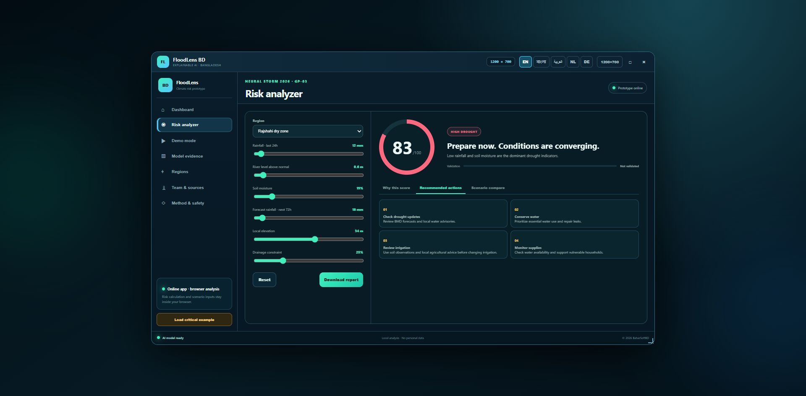

# FloodLens BD — GP-03

Educational flood and drought scenario screening for Bangladesh, aligned with Neural Storm's Green Planet GP-03 challenge. This is an illustrative prototype, not an official warning service.

Solo participant: MD Zakir Hossain — product concept, interface design, engineering, Python/AI implementation, evaluation, documentation and presentation.

Live demo: https://floodlens.baharsoftbd.com/

Historical-data demo: https://floodlens.baharsoftbd.com/real-data.html

Public source: https://github.com/mdzakirhossen23/floodlens-bd

## Real observations mode (November 3 addition)

Open `real-data.html` from the site's Real observations link. This mode uses 80 actual Bangladesh gauge readings from June 15–September 13, 2024, sourced from FFWC/BWDB via World Bank package RR_BGD_2025_385v2. See `data/PROVENANCE.md` and `data/WORLD_BANK_LICENSE.txt`. It is historical, not live data, and does not validate the separate scenario sandbox.

`train_real_data.py` trains ridge regression in Python to predict next-day gauge height from today's level and recent changes. It drops gap-crossing examples and uses 40 chronological training examples, 13 validation examples, and 14 final test examples. Hyperparameter selection uses validation only; final fitting excludes test targets. The Python-trained coefficients and test predictions are exported to `real-data.json`; the browser displays a historical replay.

Test MAE: model 0.0401 m, persistence 0.0386 m, linear trend 0.0293 m. The learned model does not beat these simple baselines in MAE. Do not describe this as validated flood/drought prediction or an improved forecasting service. One gauge and one season are insufficient for operational claims.

```sh
python -m pip install -r requirements.txt
python train_real_data.py
python -m unittest -v
python -m http.server 8000
```



The original Stata file is retained. To reproduce its CSV conversion, run `python -c "import pandas as pd; pd.read_stata('data/water_level.dta').to_csv('data/bangladesh_water_level.csv',index=False)"` from this folder. No synthetic rows are added. Environment versions are recorded in the exported JSON.

## Problem and approach

Communities need understandable information about water-related hazards. FloodLens demonstrates how rainfall, river level, soil moisture, forecast rainfall, elevation and drainage inputs can produce transparent scenario scores. Flood uses fixed logistic coefficients; drought uses a separate heuristic. The scenario coefficients are illustrative; no training dataset or fitted-model provenance for this sandbox was supplied. The separate historical mode has its own Python training pipeline and observed data. These scores are not calibrated probabilities. Regional inputs are examples, not live observations.

The deployed app calculates in JavaScript. `risk_model.py` is a Python reference implementation added during the November 3 fixes; it reproduces the formulas and exposes contributions. Adding it does not by itself establish compliance with the contest's primary-Python AI/ML requirement.

## Setup and run

The static demo and reference scoring scripts use Python standard-library tools. Reproducing the real-data training and all tests requires the packages in `requirements.txt`; Python 3.13 was used for verification. HTML, CSS, vanilla JavaScript and SVG are used for the interface.

```sh
python -m http.server 8000
```

Open http://localhost:8000. Use Demo mode or choose a region in Risk analyzer. Try Rajshahi for drought, Kurigram for flood, and the baseline demo for lower risk. Recommended actions and contribution factors change with the selected hazard. Scenario comparison is an illustrative change to inputs, not an intervention-effect prediction.

```sh
python risk_model.py --preset drought
python risk_model.py --preset flood
python evaluate.py
python -m unittest -v
```

Custom input order: rainfall (mm/24h), river above normal (m), soil (%), forecast (mm/72h), elevation (m), drainage constraint (%).

```sh
python risk_model.py --values 12 0.6 19 18 34 25
```

## Results and limitations

Legacy displayed synthetic flood confusion matrix: `[[73,290],[53,1584]]` (rows actual negative/positive, columns predicted negative/positive). Raw cases, label-generation procedure and original evaluation script were not supplied. `evaluate.py` recomputes arithmetic from that matrix; it does not reproduce the original benchmark or independently validate the model.

Accuracy 82.85%, precision 84.53%, recall 96.76%, F1 90.23%, specificity 20.11%, balanced accuracy 58.44%. An always-positive classifier scores 81.85% accuracy. Drought has no separate validation. The 24–72h horizon is an unvalidated target. No confidence percentage or validated latency guarantee is claimed. Real forecasting requires independent verified observations, historical labels, calibration and temporal/location holdouts.



## Development disclosure and submission status

Hosting files showed October 28, 2026 modification dates before the official November 2–4 event. The original site identified itself as pre-hackathon preparation. November 3 changes corrected drought advice and explanations, removed fabricated confidence, disclosed baseline metrics, corrected deployment-language claims and added Python reference scoring, historical-data training, evaluation and checks. Preserve and disclose prior work; organizer eligibility confirmation remains required. Do not describe this entire project as built within the event window.

Public source is published in this repository, including code, data provenance, evaluation, screenshots and AI-tool disclosure. Deadline: November 4, 2026, 8:30 PM Bangladesh time (8:00 PM IST). This package does not submit a Devpost entry or establish eligibility.

AI development disclosure: OpenAI Codex assisted with the November 3 review, code corrections, Python implementations, historical-data integration, evaluation, documentation and checks. Earlier AI-tool usage is unknown and must be completed by the participant before submission.

Official reference organizations: FFWC (https://ffwc.gov.bd/), BWDB (https://www.bwdb.gov.bd/), BMD (https://www.bmd.gov.bd/). No live integration or endorsement is claimed. Follow official guidance and local authorities for safety decisions.
